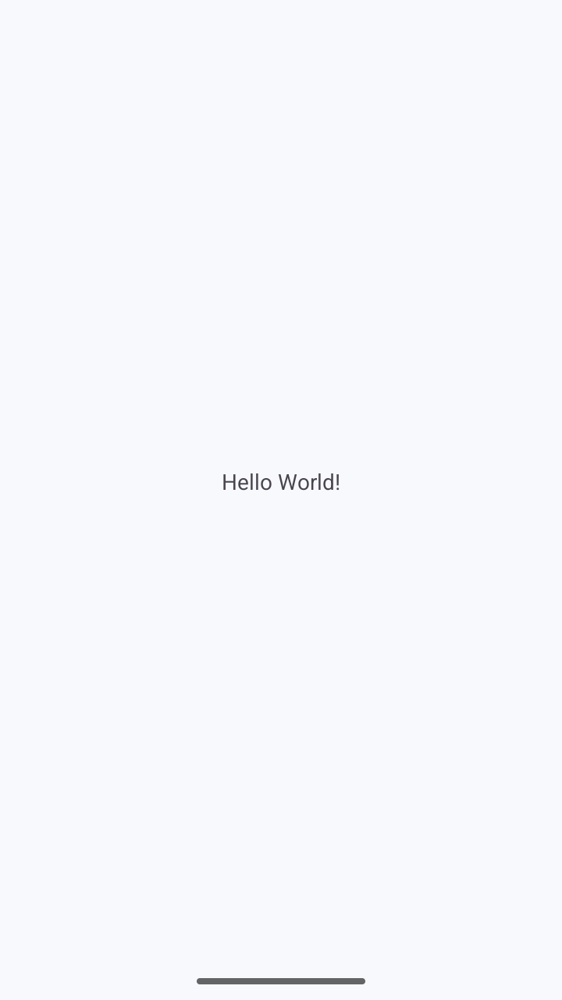

# MovieTracker

A local-first personal movie & TV tracking app for Android, built as the COMP7506 (Smartphone App Development) group project at The University of Hong Kong, 2026.

Track what you want to watch, are watching, and have watched; rate titles from 0 to 10; log each viewing session with duration and a short review; and browse your whole year in a diary-style heatmap. All data lives on your device — no account, no server.



## Features

- **Library** — add, edit, search and filter movies and TV shows by watch status (Want to Watch / Watching / Watched / Dropped).
- **Online lookup (TMDB)** — search titles on TMDB when adding a title; title, year, genres, directors, cast, synopsis, runtime, episode count and poster are filled in automatically. Duplicates are detected and blocked. Works fully offline with manual entry as a fallback.
- **Manual poster picking** — choose any image from the device as a poster, or clear it.
- **Viewing diary** — a full-year activity heatmap plus a timeline of entries grouped by date; tap a day to jump to it.
- **Home & Profile** — continue-watching list, recent entries, monthly overview, collection stats and genre breakdown.
- **Sample data** — one tap in Profile loads a curated 30-title sample library with a year of viewing history, or clears everything.

## Tech stack

| | |
| --- | --- |
| Language | Java 11 (no Kotlin sources) |
| UI | XML layouts, Material Components (Material 3), AppCompat, ConstraintLayout |
| Architecture | MVVM with ViewModel + LiveData; single Repository as the data entry point |
| Storage | Room (SQLite), local-only |
| Build | Gradle wrapper (Kotlin DSL), Android Gradle Plugin; versions catalogued in [`gradle/libs.versions.toml`](gradle/libs.versions.toml) |
| SDK | minSdk 24 · targetSdk 37 · compileSdk 37 |

## Building and running

### Requirements

- Android Studio (Hedgehog or newer; the project uses AGP 9.x — check **Help → About** for the bundled JDK)
- JDK 17+ (Android Studio's bundled JDK works)
- Android SDK 37 with build tools (Android Studio downloads these on first sync)

### Android Studio

1. Clone the repository:
   ```bash
   git clone https://github.com/Neilwwz3/group-5-android-app-dev.git
   ```
2. Open the folder via **File → Open** and wait for Gradle sync to finish. Android Studio generates `local.properties` with your SDK path — never commit it.
3. Pick an emulator or a connected device and press **Run**.

### Command line

```bash
./gradlew assembleDebug        # Windows: gradlew.bat assembleDebug
# APK output: app/build/outputs/apk/debug/app-debug.apk

./gradlew installDebug         # install onto a running device/emulator
./gradlew test                 # unit tests
./gradlew connectedDebugAndroidTest   # instrumentation tests
```

### TMDB API key (optional, enables online title lookup)

The app builds and runs without a key — the "Search titles online (TMDB)" entry is simply hidden. To enable it:

1. Get a free v3 API key from [themoviedb.org](https://www.themoviedb.org/settings/api).
2. Add one line to your **local** `local.properties` (already gitignored):
   ```properties
   tmdbApiKey=your_key_here
   ```
3. Sync Gradle and run. The key is injected into `BuildConfig` at build time and is never stored in the repository.

## Architecture & documentation

- [`docs/architecture.md`](docs/architecture.md) — module layout, data flow, navigation.
- [`docs/data-api.md`](docs/data-api.md) — the Repository API used by all UI layers.
- [`docs/design/design-system.md`](docs/design/design-system.md) — colors, typography, spacing.
- [`docs/research/competitors.md`](docs/research/competitors.md) — competitor analysis (Letterboxd, IMDb, Douban).
- [`docs/sample-data.md`](docs/sample-data.md) — how the bundled sample dataset was generated.

All user-facing text in the app is English; strings live in `res/values/strings.xml`.

## Contributing

See [CONTRIBUTING.md](CONTRIBUTING.md) for the branch/PR workflow and code conventions. All pull requests target the `dev` branch and require a green CI build plus one approving teammate.

## Acknowledgments

- Data and artwork provided by [The Movie Database (TMDB)](https://www.themoviedb.org). This product uses the TMDB API but is not endorsed or certified by TMDB.

## License

[MIT](LICENSE)
